<p align="center">
  <a href="https://github.com/ishandutta2007/Awesome-Mobile-Development-Frameworks">
    
  </a>
</p>

# 📱 Awesome Mobile Development Frameworks

<p align="center">
  <a href="https://github.com/ishandutta2007/Awesome-Awesome-Awesome"></a><a href="https://discord.gg/jc4xtF58Ve"></a> <a href="https://github.com/ishandutta2007/Awesome-Mobile-Development-Frameworks/stargazers"></a> <a href="https://github.com/ishandutta2007/Awesome-Mobile-Development-Frameworks/network/members"></a> <a href="https://github.com/ishandutta2007/Awesome-Mobile-Development-Frameworks/blob/main/LICENSE"></a> <a href="https://github.com/ishandutta2007/Awesome-Mobile-Development-Frameworks/pulls"></a> <a href="https://github.com/ishandutta2007"></a>
</p>

---

## 🌟 Introduction & Ecosystem Overview

Welcome to the definitive **Awesome Mobile Development Frameworks** knowledge base — a curated, production-tested index of enterprise **SaaS Platforms (MADP)** and cutting-edge **Open-Source Frameworks** powering modern mobile software engineering.

Whether you are targeting **iOS** and **Android** through **web-technology reuse** (HTML/CSS/JS with Ionic & Capacitor), **reactive native widgets** (React Native & Expo), **direct hardware machine-code compilation** (Flutter), **memory-safe systems runtimes** (Tauri with Rust), or **drag-and-drop enterprise low-code studios** (Power Apps, Mendix, OutSystems, Retool), this guide offers direct technical transparency, real-world pricing benchmarks, and architecture trade-offs.

### 🎯 Key Focus Areas
- 🌐 **Web-Technology Reuse**: Repurpose HTML5, CSS3, JavaScript, React, Vue, and Angular skills across mobile and web.
- ⚡ **Cross-Platform Code Sharing**: Write once and deploy simultaneously to Apple App Store, Google Play Store, and Progressive Web Apps (PWAs).
- 🎨 **Native Rendering Fidelity**: Contrast WebView sandboxing against native platform primitives (UIKit/View) and custom canvas rendering (Skia/Impeller).
- 💼 **Enterprise Low-Code Platforms (MADP)**: Accelerate internal operations and field-service software without managing Xcode or Android Studio build pipelines.

---

## 📑 Table of Contents

- [📊 Sector Overview & Market Dynamics](#-sector-overview--market-dynamics)
- [🏢 SaaS & Enterprise Platforms](#-saas--enterprise-platforms)
- [🔓 Open-Source GitHub Projects](#-open-source-github-projects)
- [⚖️ Architectural Comparison & Trade-Offs](#️-architectural-comparison--trade-offs)
- [🤝 How to Contribute](#-how-to-contribute)
- [📈 Star History](#-star-history)
- [💖 Support & Community](#-support--community)
- [📄 License & Disclaimer](#-license--disclaimer)

---

## 📊 Sector Overview & Market Dynamics

The global **Mobile Application Development Platform (MADP)** market is estimated at **$19.5 Billion to $23.8 Billion in 2025–2026** and is accelerating at a compound annual growth rate (**CAGR**) of **~21% to 23%**, with the broader enterprise mobile app development services sector surpassing **$338 Billion**.

The sector exhibits a **bifurcated, moderately fragmented market structure**:
- **Enterprise Layer (Concentrated / Incumbent-Led)**: Enterprise IT governance, legacy integration, and workforce mobility are anchored by multi-billion-dollar incumbents such as Microsoft (Power Apps), Salesforce, ServiceNow, and OutSystems. These platforms lock in enterprise IT budgets through unified identity, compliance (SOC 2, HIPAA, FedRAMP), and deep ERP/CRM hooks.
- **Developer & Engineering Layer (Highly Fragmented & Competitive)**: In consumer applications and developer-led engineering teams, no single "winner-take-all" vendor dominates. Engineering organizations dynamically pick between open-source native compilation runtimes (**Flutter**, **React Native**), lightweight web bridges (**Capacitor**, **Tauri**, **Ionic**), and developer-friendly internal tool builders (**FlutterFlow**, **Retool**, **Appsmith**, **ToolJet**), maintaining an agile and highly competitive landscape.

---

## 🏢 SaaS & Enterprise Platforms

The table below compiles leading hosted and enterprise low-code mobile application development platforms, sorted in **descending order by company valuation / market capitalization**.

| 🏷️ Product | 💰 Valuation / Revenue | 💳 Starting Price | 🎁 Free Tier / Free Trial Limits | 📱 Primary Capabilities & Architecture |
| :--- | :--- | :--- | :--- | :--- |
| **[Microsoft Power Apps](https://powerapps.microsoft.com/)** | **~$3.10 Trillion Market Cap** (NASDAQ: MSFT)<br>• Rev: $245B+ ARR | **$5.00 / user / app / mo** (Per-App plan)<br>• or **$20.00 / user / mo** (Unlimited apps) | **30-Day Free Trial** with full platform capabilities & Dataverse (or permanent free **Microsoft 365 Developer Sandbox** renewable every 90 days with 25 developer seats) | Enterprise low-code platform integrated with Microsoft Dataverse and Copilot AI. Employs responsive canvas and model-driven rendering for iOS/Android internal workforce tools. |
| **[Salesforce Platform & SDK](https://developer.salesforce.com/mobile-sdk)** | **~$290 Billion Market Cap** (NYSE: CRM)<br>• Rev: $38.0B ARR | **$25.00 / user / mo** (Platform Starter, billed annually)<br>• or **$100.00 / user / mo** (Platform Plus) | **Free Forever Developer Edition** (includes 2 Salesforce licenses, 5 MB data storage, 20 MB file storage, up to 400 custom objects) or **30-Day Free Trial** of full CRM platform | Native iOS (Swift), Android (Kotlin), and hybrid mobile bridges connected to Salesforce CRM objects. Offers Lightning Web Components (LWC) and Flow mobile builders. |
| **[ServiceNow Mobile (App Engine)](https://www.servicenow.com/products/app-engine.html)** | **~$200 Billion Market Cap** (NYSE: NOW)<br>• Rev: $10.9B ARR | **~$75.00 / user / mo** (App Engine Starter fulfiller seat, annual enterprise contract) | **Free Forever Personal Developer Instance (PDI)** with full Now Platform & App Engine Studio (hibernates after 10 consecutive days of inactivity; single developer sandbox) | Extends enterprise IT, HR, and custom operational workflows into native iOS and Android apps with offline caching, mobile push alerts, and barcode scanning. |
| **[Mendix](https://www.mendix.com/)** (Siemens) | **~$150 Billion Market Cap** (Siemens AG ETR: SIE; acquired for $730M)<br>• Rev: ~$350M+ ARR | **$1,090.00 / mo** (Standard One-App tier, up to 50 internal users, billed annually) | **Free Forever Free Edition** (1 public Mendix Cloud sandbox environment, 0.5 GB RAM, 1 GB storage, up to 5 active collaborators; automatically sleeps after 1 hour of inactivity) | Model-driven visual low-code IDE (Studio Pro) compiling directly into React Native mobile clients with offline-first synchronization and microflow orchestration. |
| **[OutSystems](https://www.outsystems.com/)** | **~$9.50 Billion Valuation** (Private / KKR)<br>• Rev: ~$300M+ ARR | **~$3,025.00 / mo** ($36,300/yr base OutSystems Developer Cloud subscription) | **Free Forever Personal Edition** (1 single cloud environment, up to 100 internal users, 1–2 GB DB storage, capped at 10 min/day custom code & 30 min/day timers; community support) | High-performance enterprise low-code platform compiling to native iOS and Android binaries via native bridges. Features full-stack visual modeling and enterprise CI/CD governance. |
| **[Zoho Creator](https://www.zoho.com/creator/)** | **~$5.00+ Billion Valuation** (Private / Bootstrapped)<br>• Rev: $1.4B+ ARR | **$8.00 / user / mo** (Standard tier, billed annually)<br>• or **$20.00 / user / mo** (Professional) | **Free Forever Plan** (1 user, 1 active application, 250 MB data storage, 3 scheduled automation workflows per month) or **15-Day Free Trial** with unrestricted features | Deluge-scripted rapid application builder that auto-generates native iOS and Android companion apps with geolocation capture, offline forms, and 600+ SaaS connectors. |
| **[Retool Mobile](https://retool.com/products/mobile)** | **~$3.20 Billion Valuation** (Series C)<br>• Rev: ~$100M+ ARR | **$10.00 / standard user / mo** + **$5.00 / end-user / mo** (Team plan, billed annually) | **Free Forever Plan** (up to 5 total users/builders, unlimited web and mobile apps, 500 workflow runs/month, 5 GB storage, 250 AI credits, community support) | Native mobile application studio (React Native runtime underneath) tailored for field operations, inventory scanning, barcode parsing, and direct database queries. |
| **[Appian](https://appian.com/)** | **~$2.70 Billion Market Cap** (NASDAQ: APPN)<br>• Rev: $615M ARR | **$75.00 / user / mo** (Standard Application user, billed annually) | **Free Forever Community Edition** (15 active users per workspace, shared multi-tenant environment, sandbox database schema, auto-expires upon extended inactivity) | Process-centric BPM and case management platform. Uses SAIL (Self-Assembling Interface Layer) to automatically project workflows to native iOS and Android mobile interfaces. |
| **[Bubble](https://bubble.io/)** | **~$500 Million Valuation** (Series A)<br>• Rev: ~$35M+ ARR | **$29.00 / mo** (Starter tier, billed annually)<br>• or **$32.00 / mo** (billed monthly) | **Free Forever Plan** (1 editor seat, core visual workflow engine, shared server compute, Bubble branding, staging environment; no custom domain or native build export) | Visual no-code application framework with native mobile builder functionality, visual relational database modeling, drag-and-drop workflow canvas, and extensive plugin marketplace. |
| **[FlutterFlow](https://flutterflow.io/)** | **~$220 Million Valuation** (Series A)<br>• Rev: ~$18M+ ARR | **$30.00 / user / mo** ($24/mo billed annually for Standard plan)<br>• or **$70.00 / user / mo** (Pro) | **Free Forever Plan** (2 active projects, 1 editor seat, 2 API endpoints, 5 lifetime AI generation queries, 10 Lite credits, 20-min test sessions; no source code or APK export) | Visual development studio generating clean, idiomatic Flutter (Dart) source code. Direct integration with Firebase, Supabase, GitHub, and one-click App Store and Google Play publishing. |

---

## 🔓 Open-Source GitHub Projects

The following open-source frameworks, runtime bridges, and low-code mobile engines are **ranked in descending order by GitHub stargazer count**. Beside each project name is an interactive social Stars_Badge linking directly to that repository's stargazers.

### 1. 💙 [Flutter](https://github.com/flutter/flutter) [](https://github.com/flutter/flutter/stargazers)
- **Primary Tech Stack**: Dart, C++, Skia / Impeller Rendering Engine
- **License**: BSD-3-Clause
- **Description**: Google's portable UI toolkit for compiling multi-platform applications directly into native ARM64/x64 machine code. Bypasses OEM platform widgets and JavaScript bridges by drawing every pixel directly onto the GPU canvas via the Impeller engine.
- **Key Features**: Stateful Hot Reload, pixel-perfect Cupertino (iOS) and Material 3 (Android) widget libraries, unified codebase across iOS, Android, Web, macOS, Windows, and Linux.
- **Best Suited For**: Consumer applications requiring high-framerate (60/120fps) custom animations, brand-heavy UI, and hardware-accelerated graphics.

### 2. ⚛️ [React Native](https://github.com/facebook/react-native) [](https://github.com/facebook/react-native/stargazers)
- **Primary Tech Stack**: JavaScript, TypeScript, React, C++, Hermes Engine
- **License**: MIT
- **Description**: Meta's flagship framework for crafting native mobile applications using React and JavaScript. Renders authentic native iOS (`UIKit`) and Android (`View`) components rather than WebViews.
- **Key Features**: The **New Architecture** incorporates the **Hermes** JavaScript engine, **Fabric** concurrent C++ renderer, and **TurboModules** via the JavaScript Interface (**JSI**), completely replacing legacy asynchronous JSON bridge bottlenecks.
- **Best Suited For**: Engineering teams with React/Web expertise demanding authentic native platform feel, massive npm package compatibility, and rapid Fast Refresh iteration.

### 3. 🦀 [Tauri](https://github.com/tauri-apps/tauri) [](https://github.com/tauri-apps/tauri/stargazers)
- **Primary Tech Stack**: Rust, WKWebView (iOS), Android WebView (Android), TypeScript
- **License**: MIT / Apache-2.0
- **Description**: Tauri v2 brings its ultra-lightweight, memory-safe architecture to mobile. Unlike Electron or Cordova, it embeds the operating system's native WebView, paired with a compiled, memory-safe Rust backend runtime.
- **Key Features**: Ultra-small binary outputs (<15 MB), minimal RAM footprint, granular security capabilities, and complete frontend independence (use React, Vue, Svelte, Solid, or vanilla HTML).
- **Best Suited For**: Security-conscious and memory-constrained applications needing the smallest possible bundle sizes combined with high-performance Rust hardware logic.

### 4. 🚀 [Expo](https://github.com/expo/expo) [](https://github.com/expo/expo/stargazers)
- **Primary Tech Stack**: React Native, TypeScript, Node.js
- **License**: MIT
- **Description**: An open-source framework and workflow orchestration ecosystem wrapping React Native. Eliminates native compilation complexity through pre-configured native modules and instant sandbox testing.
- **Key Features**: **Expo Router** (file-based routing for mobile & web), **Expo Go** (instant on-device testing without local Xcode/Android Studio installations), Config Plugins for automated native configuration, and EAS (Expo Application Services) for automated cloud compilation.
- **Best Suited For**: Startups, indie developers, and cross-platform web teams wanting zero-config React Native development without the maintenance overhead of native iOS/Android build files.

### 5. ⚡ [Ionic Framework](https://github.com/ionic-team/ionic-framework) [](https://github.com/ionic-team/ionic-framework/stargazers)
- **Primary Tech Stack**: Web Components, TypeScript, HTML5, CSS3, Angular / React / Vue
- **License**: MIT
- **Description**: The cross-platform UI toolkit built entirely on modern Web Components. Delivers over 100 polished mobile components that dynamically conform to iOS (Cupertino) and Android (Material Design) design guidelines.
- **Key Features**: Framework-agnostic core with first-class adapters for Angular, React, and Vue. Pairs with Capacitor to package standard web applications into production-ready native binaries.
- **Best Suited For**: Web-first teams aiming to share 90%+ of their code between desktop web, PWAs, and mobile app store releases using existing frontend development talent.

### 6. 🛠️ [ToolJet](https://github.com/ToolJet/ToolJet) [](https://github.com/ToolJet/ToolJet/stargazers)
- **Primary Tech Stack**: TypeScript, React, Node.js, NestJS
- **License**: AGPL-3.0
- **Description**: An extensible, open-source low-code platform engineered for building enterprise tools and mobile-responsive dashboards.
- **Key Features**: 45+ pre-built drag-and-drop widgets, dedicated mobile canvas layout modes, built-in JavaScript/Python query transformations, and 50+ out-of-the-box data connectors (PostgreSQL, MongoDB, BigQuery, Snowflake, REST APIs).
- **Best Suited For**: Internal operations, warehouse inventory scanners, and field-service portals that need rapid deployment across both desktop browsers and mobile devices.

### 7. 🧩 [Appsmith](https://github.com/appsmithorg/appsmith) [](https://github.com/appsmithorg/appsmith/stargazers)
- **Primary Tech Stack**: Java (Spring Boot), TypeScript, React
- **License**: Apache-2.0
- **Description**: Open-source, developer-centric low-code platform for building administrative panels, operational consoles, and mobile forms.
- **Key Features**: Responsive drag-and-drop canvas with adaptive mobile viewport layouts, full Git-based version control for CI/CD branching, complex JS object manipulation, and one-command self-hosting via Docker or Kubernetes.
- **Best Suited For**: Engineering teams wanting a self-hosted, code-capable internal application builder with robust access controls and responsive mobile views.

### 8. 📦 [Budibase](https://github.com/Budibase/budibase) [](https://github.com/Budibase/budibase/stargazers)
- **Primary Tech Stack**: Node.js, Svelte, CouchDB, Docker
- **License**: GPL-3.0
- **Description**: An open-source low-code platform turning data into modern internal applications, forms, and automated business workflows.
- **Key Features**: Lightweight Svelte-powered client rendering, built-in internal database with CouchDB, automated CRUD generation, enterprise SSO integration, and 1-click Progressive Web App (PWA) installation on mobile devices.
- **Best Suited For**: IT administrators and operations teams needing secure, self-hosted internal mobile forms and database managers.

### 9. 🔌 [NativeScript](https://github.com/NativeScript/NativeScript) [](https://github.com/NativeScript/NativeScript/stargazers)
- **Primary Tech Stack**: JavaScript, TypeScript, Angular, Vue, Svelte, React
- **License**: Apache-2.0
- **Description**: Open-source runtime enabling developers to call 100% of native iOS and Android APIs directly from JavaScript or TypeScript with zero WebView wrapping.
- **Key Features**: Direct reflection-based native API bridge, native platform view rendering, support for all popular web frameworks (Angular, Vue, Svelte, React), and complete access to CocoaPods and Android Gradle dependencies.
- **Best Suited For**: Developers demanding true native widget performance and full native hardware access without needing to write Swift or Kotlin bridge boilerplate.

### 10. 🧱 [NocoBase](https://github.com/nocobase/nocobase) [](https://github.com/nocobase/nocobase/stargazers)
- **Primary Tech Stack**: Node.js, React, TypeScript, Koa, Sequelize
- **License**: AGPL-3.0
- **Description**: Highly scalable, plugin-driven no-code and low-code framework with dedicated Mobile v2 client architecture.
- **Key Features**: Complete decoupling of data models from UI rendering, extensive micro-plugin ecosystem, role-based permission control, and mobile-responsive layout management for on-the-go data collection.
- **Best Suited For**: Enterprises requiring complete data sovereignty, customized operational workflows, and plugin-extensible mobile tooling.

### 11. 🪟 [.NET MAUI](https://github.com/dotnet/maui) [](https://github.com/dotnet/maui/stargazers)
- **Primary Tech Stack**: C#, .NET 8 / .NET 9, XAML, Blazor Hybrid
- **License**: MIT
- **Description**: Microsoft's multi-platform app UI framework unifying iOS, Android, macOS, and Windows into a single codebase and shared project system.
- **Key Features**: Native platform widget rendering, high-performance C# ahead-of-time (AOT) compilation, and Blazor Hybrid capabilities to embed web UI components inside native mobile shells with full access to device hardware.
- **Best Suited For**: Enterprise software teams with established .NET/C# codebases wanting cross-platform mobile and desktop deployment.

### 12. 🐍 [Kivy](https://github.com/kivy/kivy) [](https://github.com/kivy/kivy/stargazers)
- **Primary Tech Stack**: Python, Cython, OpenGL ES 2
- **License**: MIT
- **Description**: An open-source Python library for rapid development of applications featuring multi-touch user interfaces across iOS, Android, macOS, Windows, and Linux.
- **Key Features**: GPU-accelerated graphics pipeline via OpenGL ES 2, custom widget drawing, Python-to-Android and Python-to-iOS compilation utilities (Buildozer and python-for-android).
- **Best Suited For**: Python developers, researchers, and engineers building custom multi-touch UI tools and embedded devices without switching programming languages.

### 13. 🪶 [Flet](https://github.com/flet-dev/flet) [](https://github.com/flet-dev/flet/stargazers)
- **Primary Tech Stack**: Python, Flutter Engine, Dart
- **License**: Apache-2.0
- **Description**: Build multi-platform applications in pure Python powered under the hood by Google's Flutter rendering engine.
- **Key Features**: Write standard Python code while Flutter renders all widgets at 60/120fps; built-in state management, real-time event distribution, and zero frontend JS/Dart coding requirements.
- **Best Suited For**: Python programmers who want polished, production-grade mobile app layouts without learning Flutter or Dart.

### 14. 🌉 [Capacitor](https://github.com/ionic-team/capacitor) [](https://github.com/ionic-team/capacitor/stargazers)
- **Primary Tech Stack**: TypeScript, Swift, Kotlin, Swift Package Manager (SPM)
- **License**: MIT
- **Description**: The modern native runtime and hardware bridge for web applications. Successor to Apache Cordova, engineered by the Ionic team.
- **Key Features**: Seamlessly wraps any modern web application (React, Vue, Svelte, Angular, Vite, Next.js) into native Xcode and Android Studio projects. Provides clean, TypeScript-first hardware plugin APIs for camera, push notifications, filesystem, biometrics, and geolocation.
- **Best Suited For**: Frontend developers seeking a transparent, maintainable bridge between standard web single-page apps (SPAs) and App Store / Google Play binaries.

### 15. 🗄️ [Baserow](https://github.com/baserow/baserow) [](https://github.com/baserow/baserow/stargazers)
- **Primary Tech Stack**: Python (Django), Vue.js (Nuxt), PostgreSQL
- **License**: MIT
- **Description**: Open-source no-code database and application builder offering customizable relational schemas, customer portals, and mobile-friendly web applications.
- **Key Features**: Real-time collaborative data grids, role-based row-level permissions, webhooks, REST APIs, and responsive mobile-optimized interfaces compliant with GDPR and HIPAA.
- **Best Suited For**: Organizations seeking an open-source, mobile-accessible relational database alternative to Airtable.

### 16. 🔄 [Joget](https://github.com/jogetworkflow/jw-community) [](https://github.com/jogetworkflow/jw-community/stargazers)
- **Primary Tech Stack**: Java, Spring Boot, PWA Runtimes
- **License**: GPL-3.0
- **Description**: An open-source no-code/low-code platform combining visual workflow process automation with rapid mobile and web application design.
- **Key Features**: Visual drag-and-drop form and process designers, automatic Progressive Web App (PWA) generation, plugin architecture, and marketplace ecosystem.
- **Best Suited For**: Business analysts and operations teams building enterprise approval workflows, audits, and mobile field-inspection forms.

### 17. 🏢 [Convertigo](https://github.com/convertigo/convertigo) [](https://github.com/convertigo/convertigo/stargazers)
- **Primary Tech Stack**: Java, Eclipse, FullSync (CouchDB/PouchDB)
- **License**: AGPL-3.0
- **Description**: Enterprise full-stack low-code MBaaS (Mobile Backend as a Service) platform tailored for mobilizing legacy enterprise backends.
- **Key Features**: **FullSync** offline data synchronization engine with conflict resolution, visual No-Code Studio, enterprise connectors (SAP, IBM mainframes, SQL, SOAP), and cross-platform mobile client compilation.
- **Best Suited For**: Legacy enterprise systems requiring secure mobile applications with robust offline data synchronization.

---

## ⚖️ Architectural Comparison & Trade-Offs

Choosing the ideal mobile development framework depends on the trade-offs between **development speed**, **native device fidelity**, **rendering architecture**, and **talent availability**:

```
+--------------------------------------------------------------------------------------------------+
|                                    MOBILE FRAMEWORK ARCHITECTURES                                 |
+------------------------------+----------------------------------+--------------------------------+
|  1. WebView-Based / Bridges  |  2. Reactive Native Runtimes     |  3. Compiled Direct-to-GPU     |
|     (Ionic, Capacitor,       |     (React Native, NativeScript, |     (Flutter Engine,           |
|      Tauri Mobile)           |      .NET MAUI)                  |      Flet)                     |
+------------------------------+----------------------------------+--------------------------------+
| • HTML5 / CSS3 / JS in       | • JS/C# logic drives real OEM    | • Bypasses OEM platform views  |
|   system WebView             |   widgets (UIKit & Android View) | • Draws pixels directly via    |
| • Maximum code reuse         | • Authentic OS look & feel       |   Skia / Impeller to GPU       |
| • WebView performance limit  | • JSI/AOT bridge communication   | • Pixel-perfect consistency    |
| • Easiest learning curve     | • Broad ecosystem & plugins      | • Larger base binary footprint |
+------------------------------+----------------------------------+--------------------------------+
```

### Architectural Comparison Matrix

| Architecture Category | Representative Frameworks | Rendering Engine | Hardware API Access | Code Sharing Ratio | Ideal Scenario |
| :--- | :--- | :--- | :--- | :--- | :--- |
| **Direct GPU Compiled** | Flutter, Flet | Impeller / Skia (Direct to GPU) | High (Platform Channels) | ~90%–95% (Single UI codebase) | Consumer apps with custom brand designs, 120fps animations, cross-platform games. |
| **Reactive Native Bridge** | React Native, Expo, NativeScript | Native OEM Widgets (UIKit / Android View) | High (JSI / C++ TurboModules) | ~80%–90% (Native UI differences) | High-end apps requiring authentic platform look-and-feel with deep React integration. |
| **Web-to-Native Shell** | Ionic, Capacitor, Tauri | System WebView (WKWebView / Chromium) | Moderate to High (Capacitor/Rust Plugins) | ~95%–100% (Direct web app reuse) | SaaS portals, CRUD apps, internal tools, and rapid MVP deployment by web teams. |
| **Enterprise Low-Code / MADP** | Power Apps, Mendix, OutSystems, Retool | Dynamic Container / Microflow Engine | Pre-configured (Camera, GPS, Barcode) | ~100% (No manual compilation) | Enterprise internal workflows, field service, BPM approvals, and rapid citizen development. |

---

## 🤝 How to Contribute

We welcome additions, corrections, and benchmark improvements from the mobile engineering community!

1. 🍴 **Fork the repository** to your personal GitHub account.
2. 🌿 **Create a descriptive branch**:
   ```bash
   git checkout -b feat/add-framework-name
   ```
3. 📝 **Add your entry** to `README.md`:
   - Follow existing formatting, Markdown styles, and accurate metrics.
   - For SaaS additions, provide exact starting tier pricing and specific free tier/trial limits.
   - For Open-Source additions, include the official repository link, stargazers social badge, and place it in the correct descending Stars_Count position.
4. 🧪 **Verify all links and Markdown formatting**.
5. 🚀 **Submit a Pull Request** with a concise summary of the addition or update.

---

## 📈 Star History

[](https://star-history.dera.page/#ishandutta2007/Awesome-Mobile-Development-Frameworks&type=date&legend=top-left)

---

## 💖 Support & Community

Thank you so much for exploring and supporting **Awesome-Mobile-Development-Frameworks**! If this curated repository has helped you or your engineering team:

- ⭐ **Star this repository** to help other engineers discover it.
- 🍴 **Fork and contribute** your favorite frameworks, plugins, or architectural benchmarks.
- 📢 **Share with colleagues** across Discord, Reddit, X (Twitter), and LinkedIn.
- ☕ **Support the maintainer**: If you would like to buy a coffee or sponsor ongoing maintenance of our Awesome collection, please visit the [GitHub Sponsor Dashboard](https://github.com/sponsors/ishandutta2007).

---

## 📄 License & Disclaimer

- **License**: Licensed under the [MIT License](LICENSE).
- **Disclaimer**: This compilation is community-curated for informational and comparative purposes. Product names, logos, and brands are property of their respective owners. Performance, pricing, and feature sets change over time; always consult official documentation before committing to enterprise production architectures.
